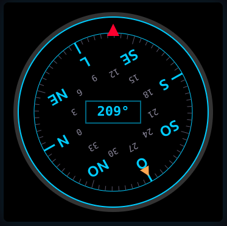
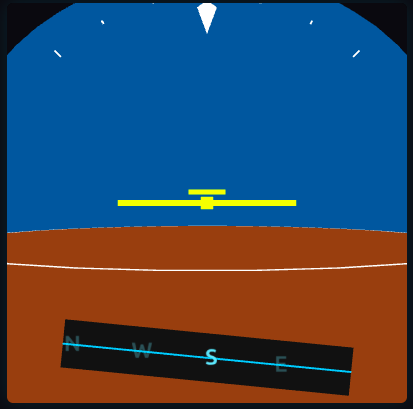

# 🧭 Compass HSI — HMC5883L + Arduino Uno

Digital compass with **HSI (Horizontal Situation Indicator)** and **PFD (Primary Flight Display)** aviation-style displays, reading data from the HMC5883L magnetometer (GY-273) via serial and rendering in real-time in the browser.

## Screenshots

| HSI 2D (Compass Rose) | PFD 3D (Attitude Indicator) |
|:---:|:---:|
|  |  |

## Hardware

| Component | Wiring |
|---|---|
| **GY-273 (HMC5883L)** | VCC→5V, GND→GND, SDA→A4, SCL→A5 |
| **Arduino Uno R3** | Connected via USB |

## Software

- **Arduino sketch** (`compass.ino`): reads the HMC5883L via I2C and sends JSON over serial every 200ms
- **HSI 2D** (`compass_2d.html`): rotating compass rose, lubber line, heading bug and digital readout
- **PFD 3D** (`compass_3d.html`): attitude indicator with sky/ground, heading tape, bank angle scale — uses **Three.js**

Both web pages use **Web Serial API** (Chrome/Edge only).

## Usage

1. **Upload the sketch** to the Arduino:
   ```bash
   arduino-cli compile --fqbn arduino:avr:uno compass
   arduino-cli upload -p /dev/ttyACM0 --fqbn arduino:avr:uno compass
   ```

2. **Open** `compass_2d.html` or `compass_3d.html` in Chrome or Edge

3. **Click "Connect"** and select the Arduino serial port

4. **Rotate the module** and watch the display update in real-time

## Data format

```json
{"x":-147,"y":-217,"z":-75,"h":235.9,"m":251}
```

| Field | Description |
|---|---|
| `x`, `y`, `z` | Raw axis values (LSB) |
| `h` | Heading in degrees (0-360) |
| `m` | Magnetic field strength in mG |

## Structure

```
compass/
├── compass.ino        # Arduino sketch (I2C → Serial JSON)
├── compass_2d.html    # HSI 2D (Web Serial API → Canvas)
├── compass_3d.html    # PFD 3D (Web Serial API → Three.js)
├── screenshot_2d.png  # HSI 2D screenshot
├── screenshot_3d.png  # PFD 3D screenshot
└── README.md          # This file
```
